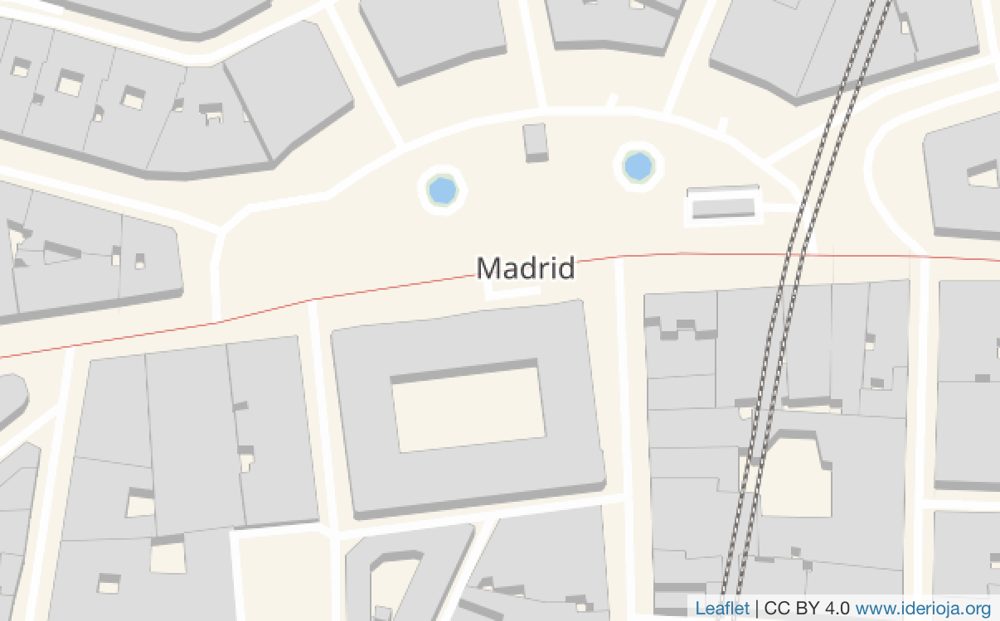

[](https://github.com/dieghernan/leaflet-providersESP/actions/workflows/codeql-analysis.yml)

[](https://doi.org/10.5281/zenodo.5731395)
[](https://ko-fi.com/dieghernan)
[](https://app.fossa.com/projects/git%2Bgithub.com%2Fdieghernan%2Fleaflet-providersESP?ref=badge_shield)

# leaflet-providersESP

An extension to Leaflet that contains configurations for various free WMS/WMTS
tile providers of Spain.

Compatible with
[leaflet-providers](https://github.com/leaflet-extras/leaflet-providers)

## Installation

Load Leaflet's CSS and JavaScript first, then load leaflet-providersESP. The
plugin works directly with Leaflet; loading leaflet-providers is optional.

### Via CDN

Use `v1.4.0` with Leaflet `1.9.4`. The CDN URLs below become available after
the `v1.4.0` tag is published; until then, use the local distribution files:

``` html
<link rel="stylesheet" href="https://cdn.jsdelivr.net/npm/leaflet@1.9.4/dist/leaflet.css">
<script src="https://cdn.jsdelivr.net/npm/leaflet@1.9.4/dist/leaflet.js"></script>
<script src="https://cdn.jsdelivr.net/gh/dieghernan/leaflet-providersESP@v1.4.0/dist/leaflet-providersESP.min.js"></script>
```

To follow development on `main`, replace only the plugin script with this URL:

``` html
<script src="https://cdn.jsdelivr.net/gh/dieghernan/leaflet-providersESP@main/dist/leaflet-providersESP.min.js"></script>
```

The `main` URL follows that branch and may change. Changes in this checkout
can be tested with the local files below.

### Local

Copy `dist/leaflet-providersESP.min.js` next to your HTML file and replace the
plugin script in the complete example below with:

``` html
<script src="./leaflet-providersESP.min.js"></script>
```

You can also copy `dist/leaflet-providersESP.js` and use
`src="./leaflet-providersESP.js"` for the readable source. Both files are in
[dist/](dist/). Keep the Leaflet CSS and JavaScript includes before the plugin.

## Usage

Save this complete example as `index.html` and open it in a browser. The map
container needs an explicit height to be visible.

``` html
<!doctype html>
<html lang="en">
<head>
    <meta charset="utf-8">
    <meta name="viewport" content="width=device-width, initial-scale=1">
    <title>Map of Spain</title>
    <link rel="stylesheet" href="https://cdn.jsdelivr.net/npm/leaflet@1.9.4/dist/leaflet.css">
    <script src="https://cdn.jsdelivr.net/npm/leaflet@1.9.4/dist/leaflet.js"></script>
    <script src="https://cdn.jsdelivr.net/gh/dieghernan/leaflet-providersESP@v1.4.0/dist/leaflet-providersESP.min.js"></script>
    <style>
        html, body { height: 100%; margin: 0; }
        #map { height: 100%; width: 100%; }
    </style>
</head>
<body>
    <div id="map"></div>
    <script>
var map = L.map('map').setView([40.4166, -3.7038], 12);
L.tileLayer.providerESP('IGNBase.Todo').addTo(map);
    </script>
</body>
</html>
```



[Full demo](https://dieghernan.github.io/leaflet-providersESP/) and
[providers](https://dieghernan.github.io/leaflet-providersESP#proveedores-disponibles)
(ES).

## Copernicus services

Version 1.4.0 uses the official EEA services for the existing Copernicus
2012 and 2015 products. Public variant names are unchanged; coverage follows the
European products rather than the retired Spain service. `ForestLeaf` requests
EPSG:4326 automatically, including on a default Leaflet Mercator map. The other
variants use EPSG:3857. Resolution and raster/vector layers are combined so the
services can select the appropriate representation at each scale.

`Copernicus.RiparianGreen` remains deprecated and unavailable at the old IGN
endpoint; no equivalent official WMS has been identified.

## Development

Use Node.js 22.13+ (22.x) or Node.js 24 or newer. Install the development
dependencies and Chromium:

``` sh
npm ci
npx playwright install chromium
```

After changing the plugin, regenerate the minified distribution with UglifyJS,
as in leaflet-providers, then run all checks before submitting a change:

``` sh
npm run build
npm test
```

Individual checks are available as `npm run lint`, `npm run test:unit` and
`npm run test:browser`. ESLint checks the JavaScript files and inline scripts in
HTML, following the conventions of
[leaflet-providers](https://github.com/leaflet-extras/leaflet-providers). Use
`npm run lint:fix` to apply automatic formatting fixes. Keep the copies of
`leaflet-providersESP.js` in `dist/` and `dev/` identical; the unit tests check
this. `npm run build:check` verifies that `dist/leaflet-providersESP.min.js` is
up to date without rewriting it. This check is also part of `npm test`. Both
distributions pass ESLint's correctness rules; stylistic rules apply to the
editable sources.

Browser tests exercise both the source and minified distributions with Leaflet
1.9.4 in Chromium and check WMS parameters, coordinate axis order, tile loading,
opacity, native zoom limits and compatibility with leaflet-providers in both
script-loading orders. Tile responses are controlled by the tests so remote
service outages do not affect these checks. Use the [live audit
tool](dev/capabilities-audit.md#reproduce-the-checks) to check current provider
availability separately.

The JavaScript checks workflow runs lint and tests on pushes and pull requests
to `main`. On Linux, install browser system dependencies with
`npx playwright install --with-deps chromium`, as the workflow does.

## License

[](https://app.fossa.com/projects/git%2Bgithub.com%2Fdieghernan%2Fleaflet-providersESP?ref=badge_large)

## Author identity and Webmentions

The site keeps its project branding and shows the author's avatar and name in an
h-card linked to <https://dieghernan.github.io/>. The custom head advertises the
existing Webmention.io receiver for `dieghernan.github.io`. This enables
endpoint discovery for incoming mentions; it does not display mentions or send
them.
