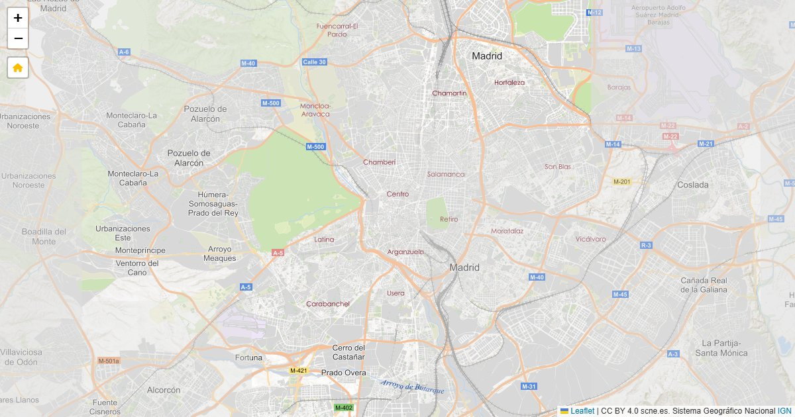

# leaflet-providersESP

Spanish public mapping services for [Leaflet](https://leafletjs.com/): add IGN
basemaps, PNOA imagery, administrative boundaries and thematic WMS/WMTS layers
with a provider name.

[](https://github.com/dieghernan/leaflet-providersESP/releases)
[](https://github.com/dieghernan/leaflet-providersESP/actions/workflows/javascript-checks.yml)
[](https://doi.org/10.5281/zenodo.5731395)



**[Explore layers](https://dieghernan.github.io/leaflet-providersESP/preview/)**
· **[Open the map](https://dieghernan.github.io/leaflet-providersESP/visor/)**
· **[Usage guide (ES)](https://dieghernan.github.io/leaflet-providersESP/guia/)**

The plugin works directly with Leaflet. You can also combine it with
[leaflet-providers](https://github.com/leaflet-extras/leaflet-providers) on the
same map.

## Installation

Load Leaflet's CSS and JavaScript first, then load leaflet-providersESP. The
plugin works directly with Leaflet; loading leaflet-providers is optional.

### Via CDN

Use the published `v1.4.0` release with Leaflet `1.9.4`:

``` html
<link rel="stylesheet" href="https://cdn.jsdelivr.net/npm/leaflet@1.9.4/dist/leaflet.css">
<script src="https://cdn.jsdelivr.net/npm/leaflet@1.9.4/dist/leaflet.js"></script>
<script src="https://cdn.jsdelivr.net/gh/dieghernan/leaflet-providersESP@v1.4.0/dist/leaflet-providersESP.min.js"></script>
```

To follow development on `main`, replace only the plugin script with this URL:

``` html
<script src="https://cdn.jsdelivr.net/gh/dieghernan/leaflet-providersESP@main/dist/leaflet-providersESP.min.js"></script>
```

The `main` URL follows that branch and may change. Changes in this checkout
can be tested with the local files below.

### Local

Copy `dist/leaflet-providersESP.min.js` next to your HTML file and replace the
plugin script in the complete example below with:

``` html
<script src="./leaflet-providersESP.min.js"></script>
```

You can also copy `dist/leaflet-providersESP.js` and use
`src="./leaflet-providersESP.js"` for the readable source. Both files are in
[dist/](dist/). Keep the Leaflet CSS and JavaScript includes before the plugin.

## Usage

Save this complete example as `index.html` and open it in a browser. The map
container needs an explicit height to be visible.

``` html
<!doctype html>
<html lang="en">
<head>
    <meta charset="utf-8">
    <meta name="viewport" content="width=device-width, initial-scale=1">
    <title>Map of Spain</title>
    <link rel="stylesheet" href="https://cdn.jsdelivr.net/npm/leaflet@1.9.4/dist/leaflet.css">
    <script src="https://cdn.jsdelivr.net/npm/leaflet@1.9.4/dist/leaflet.js"></script>
    <script src="https://cdn.jsdelivr.net/gh/dieghernan/leaflet-providersESP@v1.4.0/dist/leaflet-providersESP.min.js"></script>
    <style>
        html, body { height: 100%; margin: 0; }
        #map { height: 100%; width: 100%; }
    </style>
</head>
<body>
    <div id="map"></div>
    <script>
var map = L.map('map').setView([40.4166, -3.7038], 12);
L.tileLayer.providerESP('IGNBase.Todo').addTo(map);
    </script>
</body>
</html>
```

## Choose and combine layers

Use `Provider.Variant` to select a layer. Omitting the variant selects the
provider's default: `IGNBase` and `IGNBase.Todo` display the same cartography.
Each call creates a separate Leaflet layer.

```js
var map = L.map('map').setView([40.4166, -3.7038], 12);
var base = L.tileLayer.providerESP('IGNBase.Gris').addTo(map);
var boundaries = L.tileLayer.providerESP('UnidadesAdm.Limites', {
    opacity: 0.7
}).addTo(map);
L.control.layers({ 'IGN gray': base }, { Boundaries: boundaries }).addTo(map);
```

The [catalog](https://dieghernan.github.io/leaflet-providersESP/preview/)
lets you compare layer previews and copy code with or without the plugin.
The [map viewer](https://dieghernan.github.io/leaflet-providersESP/visor/)
lets you add basemaps and overlays to Leaflet's standard layer control and choose which ones to display. An optional location button centers the map on your position.
Documentation and map controls are in Spanish.
The [layer reference](https://dieghernan.github.io/leaflet-providersESP/capas/)
describes every layer, including coverage, scale and availability limitations.

## Availability and attribution

Coverage, zoom limits, availability and terms of use depend on each service.
Keep Leaflet's attribution control visible and check the provider's terms before
reusing its maps. The MIT license covers this plugin's code.

See the [changelog](CHANGELOG.md) for aliases, deprecated layers and known
issues, including `Copernicus.RiparianGreen`. The
[service audit](dev/capabilities-audit.md) records dated checks; inclusion in the
catalog does not guarantee that a remote service is currently available.

## Contribute

See [CONTRIBUTING.md](CONTRIBUTING.md) for development commands, tests and how to
report broken services or propose a provider.

## License

[MIT](LICENSE). This project builds on the provider configuration approach of
[leaflet-providers](https://github.com/leaflet-extras/leaflet-providers).
